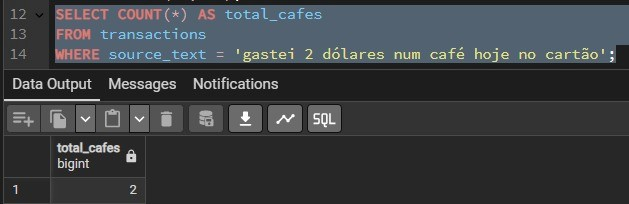
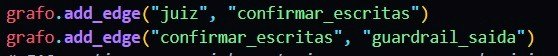
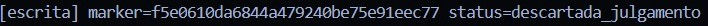
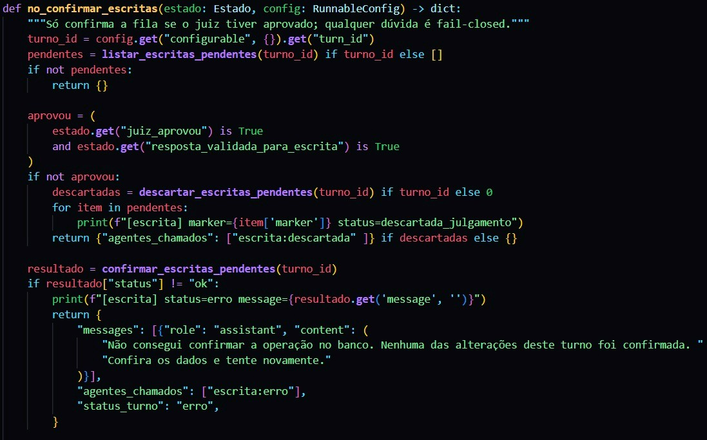
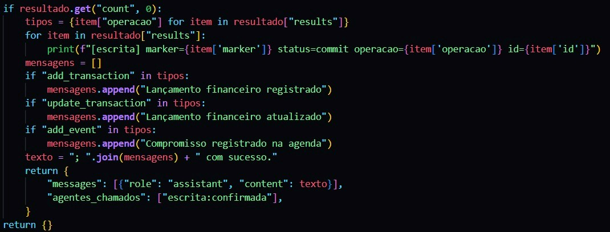
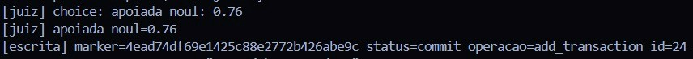
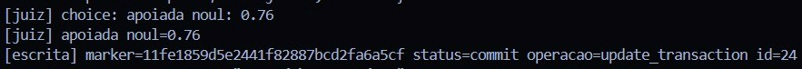

# Etapa 8 - Decisão técnica: o juiz e a escrita

A invariante que eu garanto nesta entrega é: se o turno for recusado, nenhuma escrita desse turno permanece, seja criação ou alteração, no financeiro e na agenda.

## 0. Contexto e linha de base

O defeito visto na Etapa 7 é de ordem. A tool de escrita executava INSERT ou UPDATE e dava commit() dentro dela mesma, fechava a conexão, e só depois o juiz avaliava a frase. Quando o juiz recusava, o usuário recebia "Não tenho evidência para afirmar isso.", mas a linha já estava gravada no Postgres.

Na linha de base (o projeto como estava com o juiz da Etapa 7) o caminho era `orquestrador -> guardrail_saida -> juiz -> chat`, e as tools `add_transaction`, `update_transaction` e `add_event` gravavam e davam commit() no passo das tools. `add_google_event` criava o evento no Google Calendar na hora, também antes de qualquer veredito.

## 1. Prova do defeito na linha de base

Em cada tentativa usei um marcador único e anotei o estado do Postgres antes do pedido. Depois conferi se havia linha nova (ou, no update, os valores do registro alterado). Assim cada linha fica ligada a uma única tentativa.

add_transaction: faz INSERT em transactions e commit() dentro da tool. O juiz registrou `[juiz]` com o rótulo de recusa e a linha continuou no banco.

update_transaction: faz UPDATE em transactions e commit() dentro da tool. O juiz recusou e o registro já estava alterado.

add_event: faz INSERT em events e commit() dentro da tool. O juiz recusou e o evento continuou no banco.



O rollback() que já existia em cada tool cobria apenas uma exceção SQL antes do commit(). Quando o juiz respondia, a conexão daquela tool já tinha sido fechada e não havia mais o que desfazer.

## 2. A decisão que tomei

### O que escolhi

Combinei duas famílias de solução: Adiar e Transacionar.

Adiar: as tools de escrita não gravam mais. Elas validam os dados (categoria, tipo e existência do registro, no caso do update) e colocam uma intenção numa fila do turno, identificada por um marcador UUID, no arquivo `app/tools/write_staging.py`. O retorno da tool passa a ser status "pending_approval".

Transacionar: depois do veredito, todas as intenções do Postgres aprovadas no turno são aplicadas numa única transação curta. Um commit() confirma tudo e qualquer erro faz rollback() do conjunto.

Escolhi combinar porque uma família só não bastava. Adiar sem transação deixaria efeito parcial se a segunda escrita do turno falhasse. Transacionar sem adiar me obrigaria a manter a conexão aberta durante as chamadas ao modelo e ao juiz, o que explico na seção 4.

### Qual fronteira autoriza a escrita

Criei o nó `confirmar_escritas`, logo depois do juiz. Ele só confirma a fila quando duas condições são verdadeiras ao mesmo tempo:

1. `juiz_aprovou` é True, ou seja, o juiz respondeu e classificou a frase como apoiada acima do limiar.
2. `resposta_validada_para_escrita` é True, ou seja, o JSON do especialista é do domínio certo, tem intenção de escrita e não pede esclarecimento.

Em qualquer outro caso (recusa, juiz sem resposta, timeout, chave ausente ou saída incoerente), a fila é descartada sem abrir conexão de escrita.

### Por que essa fronteira cabe neste grafo

Não criei agente novo. A fronteira é um nó comum do LangGraph, sem LLM.

As tools mantêm o mesmo nome e os mesmos argumentos. O modelo continua chamando `add_transaction`, `update_transaction`, `add_event` e `add_google_event` como antes.

Não mexi em rotas HTTP, API, frontend, nem na arquitetura dos agentes. O FAQ continua passando pelo juiz que já tinha; a única diferença é que agora sai do juiz pelo mesmo caminho dos outros (`confirmar_escritas`, sem nada na fila, e depois o guardrail de saída).

### A garantia em cada tool

add_transaction: antes fazia INSERT e commit() na tool. Agora prepara a intenção, e o INSERT só acontece em `confirmar_escritas`.

update_transaction: antes fazia UPDATE e commit() na tool. Agora resolve o id, lê o registro atual (como evidência para o juiz) e valida os campos. O UPDATE só acontece em `confirmar_escritas`, com a checagem de que exatamente uma linha foi afetada.

add_event: antes fazia INSERT e commit() na tool. Agora prepara a intenção, e o INSERT só acontece em `confirmar_escritas`.

add_google_event: antes criava o evento no Google na hora. Agora também só prepara; o Google só é chamado depois do commit do Postgres (seção 5).

### Fluxo antes

```
guardrail_entrada -> roteador -> especialista (a tool grava e dá commit) -> orquestrador -> guardrail_saida -> juiz -> chat
```

### Fluxo depois

```
guardrail_entrada -> roteador -> especialista (a tool prepara a intenção e o marcador)
-> orquestrador -> juiz -> confirmar_escritas -> guardrail_saida -> chat

aprovado: uma transação, um commit (e só então o Google Calendar)
recusado ou sem resposta: fila descartada
```



### A frase depois do commit

Quando a escrita é confirmada, monto a frase do chat a partir do retorno do commit, por exemplo "Lançamento financeiro registrado com sucesso.". A frase aprovada pelo juiz dizia que a operação estava preparada. Depois do commit, o fato verdadeiro é que ela foi gravada, e a nova frase se apoia no retorno real do banco. Se o commit falhar, o usuário recebe "Não consegui confirmar a operação no banco. Nenhuma das alterações deste turno foi confirmada.".

Se o juiz aprovou mas a saída do especialista era incoerente com a escrita, a fila também é descartada e o usuário recebe "Não consegui confirmar essa operação, então nada foi salvo.". Sem essa mensagem ele leria "preparada e aguarda aprovação" e acharia que a operação ainda estava pendente.







## 3. As decisões que não tomei

### Interceptar (julgar antes de a tool ser chamada)

Como funcionaria aqui: eu colocaria um passo entre a decisão do modelo e o ToolNode, dentro do agente criado por create_agent, e mandaria a chamada (por exemplo add_transaction com os argumentos) ao juiz antes de executar.

Vantagem real: a tool de escrita nem chegaria a rodar quando a intenção fosse recusada.

Custo real: o create_agent não expõe esse ponto. Eu teria que trocar o agente por um grafo próprio, o que significa mexer na arquitetura do especialista. Além disso, o juiz julgaria a intenção e não a frase que chega ao usuário. A frase final continuaria precisando de uma segunda chamada ao juiz, com mais latência e mais custo.

Por que deixei de fora: exige reescrever o agente e duplica o julgamento. A fila resolve o mesmo problema sem tocar no agente.

### Transacionar com a conexão aberta durante o turno

Como funcionaria aqui: eu abriria uma conexão no início do turno e passaria essa conexão pelo config do grafo. As tools executariam INSERT e UPDATE sem commit, e o nó final faria commit() ou rollback() conforme o veredito.

Vantagem real: o próprio Postgres garante o desfazer, e a tool continua escrevendo SQL normalmente.

Custo real: a transação ficaria aberta durante as chamadas ao orquestrador e ao juiz, que levam segundos. Nesse tempo os locks de linha do UPDATE ficam presos, a conexão fica ocupada e outros turnos podem esperar. Hoje as tools abrem e fecham a conexão a cada chamada pelo `get_conn`, então eu teria que mudar esse modelo também. E ela não alcança o Google Calendar, que não participa de transação do Postgres.

Por que deixei de fora: aproveitei o rollback do Postgres, mas só abro a transação depois do veredito. Ela dura milissegundos, e não segundos.

### Compensar (desfazer depois da recusa)

Como funcionaria aqui: as tools continuariam com o commit. Na recusa, um nó executaria a ação inversa: DELETE da linha criada, ou UPDATE de volta aos valores antigos no caso do update_transaction.

Vantagem real: praticamente não mudaria as tools.

Custo real: existiria uma janela em que a linha recusada fica visível para consultas e para outros turnos. O update precisaria guardar o estado anterior antes de alterar. Se o processo caísse entre a escrita e a compensação, o efeito ficaria pela metade. E se outra alteração acontecesse no meio, a compensação poderia sobrescrevê-la. No Google Calendar seria preciso um DELETE do evento, que é outra chamada externa que também pode falhar.

Por que deixei de fora: a invariante pede que o banco fique igual ao de antes do turno. Com compensação ele fica diferente por um tempo, e pode ficar diferente para sempre se algo falhar.

### Mudar só o prompt

Pedir ao modelo que não chame a tool ou que "confirme antes" não impede o commit, porque o modelo pode chamar a tool mesmo assim. O enunciado proíbe tratar isso como garantia. As regras de prompt que adicionei servem apenas para a frase não afirmar uma gravação que ainda não aconteceu.

### Caminhos que o próprio enunciado proíbe

Não considerei desligar as tools de escrita, remover o juiz ou fazê-lo aprovar sempre, apagar a linha à mão, tratar só uma frase pronta (como "2 dólares") nem corrigir só uma das tools.

## 4. Efeito nas métricas do SRE

### Na decisão que tomei

Latência do turno e p95 (SLO de 8 s): praticamente a mesma da linha de base. O orquestrador e o juiz já estavam no caminho, e não há chamada de modelo nova. Soma-se uma transação de confirmação de milissegundos e, quando há `add_google_event`, a chamada ao Google, que antes acontecia dentro da tool e agora acontece depois do commit. O timeout do juiz caiu de 30 s para 5 s para limitar a espera. O efeito colateral é que um juiz lento passa a cair em erro, o que resulta em frase segura e escrita descartada.

Taxa de erro (SLO de 5%): conta como erro o juiz sem chave, sem resposta, com erro HTTP ou com timeout, e também a falha no commit. Não conta a recusa do juiz, porque o sistema respondeu de forma segura e sem exceção, e não conta o bloqueio do guardrail de entrada.

Status: ok para resposta normal ou recusa segura, erro para falha do juiz ou da confirmação, e bloqueado para o guardrail de entrada. Passei a ler o status do campo `status_turno` do turno atual. O estado é persistido entre turnos e os rótulos em `agentes_chamados` se acumulam, então um rótulo de um turno antigo não pode contaminar o atual.

Tokens e custo: a confirmação não chama LLM, então ficam iguais aos da linha de base. O juiz externo não informa tokens ao coletor, então o custo dele não é medido. Só a latência dele entra no turno.

### Na alternativa da transação aberta durante o turno

Latência: a mesma do juiz e do orquestrador, mais a espera por locks quando dois turnos alteram a mesma linha. Isso aparece direto no p95.

Erro: uma conexão presa por segundos aumenta a chance de esgotar o pool e de timeouts de banco, que contam como exceção.

Tokens e custo: iguais aos da decisão que tomei.

Mecanismo: uma conexão aberta à espera do veredito.

### Na alternativa de compensar

Latência: soma um segundo efeito (o DELETE ou o UPDATE inverso) nos turnos recusados.

Erro: a compensação pode falhar, e aí o turno termina com erro e com uma linha indevida no banco.

Mecanismo: um segundo efeito no banco.

## 5. Outras decisões

### add_google_event

Entrou no escopo, adiada. É um efeito fora do Postgres e não se desfaz: se continuasse imediato, um turno recusado ainda deixaria o evento no Google. Ela vai para a mesma fila e só é chamada depois do commit do Postgres, e nunca se o Postgres falhou. Se o Google falhar com o Postgres já confirmado, o usuário é avisado ("Não consegui criar o evento no Google Calendar"), e o evento local existe.

A limitação é que o Google não participa da transação: entre o commit e a chamada, uma queda deixa o Postgres com o evento e o Google sem ele. Uma chave de idempotência persistida resolveria a repetição, mas exigiria mudar o schema.

### MCP

O servidor `app/mcp_server.py` expõe `add_transaction` e `update_transaction` sem juiz. Cada chamada vira um turno de uma operação só, que o próprio servidor confirma na hora. Sem `turn_id`, as tools do grafo recusam a escrita, então o caminho do grafo continua fail-closed.

### salvar_mensagem

Continua gravando no MongoDB depois que o grafo termina, portanto depois do juiz e do commit, e grava a frase que o usuário viu. Não coloquei essa escrita na transação do Postgres, porque unir dois bancos numa transação exigiria outra arquitetura. A consequência é que, se o commit do Postgres acontecer e o Mongo falhar depois, a escrita de negócio permanece e o histórico fica incompleto.

### Juiz sem resposta

Decidi que o sistema falha fechado. Com chave ausente, resposta ausente, erro HTTP ou timeout de 5 s, o usuário vê "Não tenho evidência para afirmar isso.", o banco não guarda nada deste turno porque a fila é descartada, e o monitor marca erro.

### Queda do processo

Antes da confirmação, a fila está só em memória e se perde, e nada foi gravado.

Durante o SQL e antes do commit(), o Postgres desfaz a transação quando a conexão cai.

Depois do commit() e antes da resposta, a escrita permanece, mesmo que o usuário não receba a confirmação. Esse é o limite de uma transação local.

### Repetição do mesmo pedido

No mesmo turno, uma chamada idêntica da mesma operação recebe o mesmo marcador e não duplica a intenção. A limitação é que dois lançamentos idênticos e legítimos pedidos na mesma mensagem viram um só.

Em outro turno, o pedido é tratado como novo e gera nova escrita, porque não há chave de idempotência persistida no schema.

### Concorrência

A fila é isolada pelo UUID do turno, e não pelo session_id, então dois turnos simultâneos não compartilham intenções.

No update_transaction, o id é resolvido antes do juiz e o UPDATE roda depois. Se o registro for apagado nesse intervalo, a checagem de linhas afetadas desfaz a transação inteira. Se ele for alterado por outro processo, o UPDATE aplica os campos preparados por cima, porque não há coluna de versão no schema.

### Limitações conhecidas

Quando o especialista devolve esclarecer ou acompanhamento junto com a intenção de escrita, a saída não é considerada coerente e a fila é descartada, com aviso ao usuário.

A coerência só é exigida quando há escrita pendente; consultas seguem como antes.

## 6. Evidência depois da correção

Cada intenção de escrita recebe do sistema um marcador UUID próprio, impresso no log como `[escrita] marker=... status=preparada`. Depois vêm o rótulo `[juiz] ...` e, por fim, `status=descartada_julgamento` ou `status=commit ... id=...`, com o mesmo marcador. No banco, comparei o estado antes do pedido com as linhas que apareceram depois.

Escrita recusada, descartada sem tocar no banco: ver o print 02 (seção 2).

add_transaction aprovado: o juiz respondeu `apoiada`, e o log mostra `status=commit operacao=add_transaction` com o id gravado.



update_transaction aprovado: o juiz respondeu `apoiada`, e o log mostra `status=commit operacao=update_transaction`.



Consultas que usei:

```sql
SELECT max(id) FROM transactions;
SELECT id, amount, description, occurred_at FROM transactions WHERE id > <MAX_ANTES>;
SELECT id, amount, description, occurred_at FROM transactions WHERE id = <ID_DO_TESTE>;

SELECT max(id) FROM events;
SELECT id, title, start_time, end_time FROM events WHERE id > <MAX_ANTES>;
```

### O que continua funcionando

Lançamento válido, alteração válida, evento válido, as consultas do financeiro e da agenda, o guardrail, o juiz e o monitor da Etapa 6. As consultas do financeiro neste projeto se chamam `search_transactions`, `saldo_total` e `saldo_diario`, e têm o mesmo papel de `query_transactions`, `total_balance` e `daily_balance` citadas no enunciado. A consulta da agenda é `query_events`.

## 7. Arquivos criados e modificados

### Arquivos criados

- `app/tools/write_staging.py`: fila de intenções por turno; confirmação de todas as escritas do Postgres aprovadas numa única transação e, depois dela, a chamada ao Google Calendar.
- `images/01_consulta_marcador_postgres.png` a `images/07_log_commit_update_transaction.png`: prints usados nesta decisão.
- `decisao_tecnica.md`: este documento.

### Arquivos modificados

- `app/graph.py`: liguei `orquestrador -> juiz -> confirmar_escritas -> guardrail_saida`, criei o nó `confirmar_escritas`, a checagem de coerência no orquestrador, o `status_turno`, a abertura e limpeza da fila do turno e o `turn_id` no config.
- `app/juiz.py`: passa a devolver a decisão explícita (`juiz_aprovou`) e o `status_turno`, falha fechado quando não há resposta, e o timeout caiu de 30 s para 5 s.
- `app/observabilidade.py`: o status vem do turno atual, e falha do juiz ou da confirmação conta como erro.
- `app/prompts.py`: regras no financeiro e na agenda para não afirmar gravação enquanto a tool devolve `pending_approval`.
- `app/tools/financeiro.py`: `add_transaction` e `update_transaction` passam a preparar a intenção em vez de executar INSERT ou UPDATE com commit().
- `app/tools/agenda.py`: `add_event` passa a preparar a intenção.
- `app/tools/calendario_google.py`: `add_google_event` passa a preparar a intenção; a criação real virou `criar_evento_google`, chamada só depois do commit.
- `app/mcp_server.py`: as escritas expostas por MCP confirmam na hora, como turno de uma operação.
